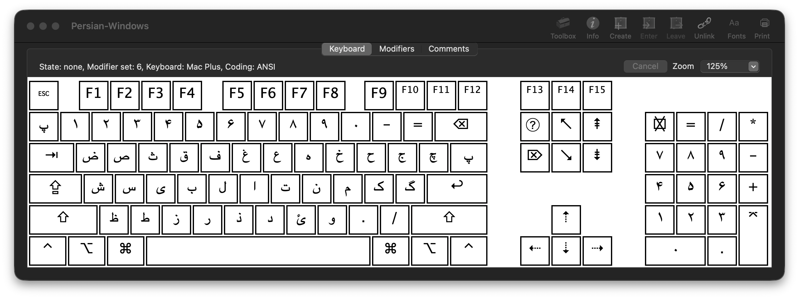
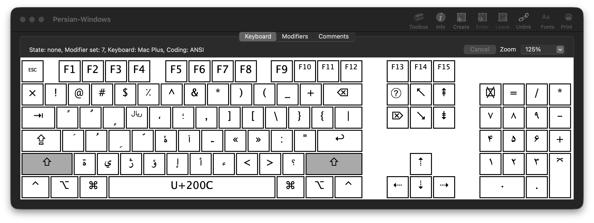
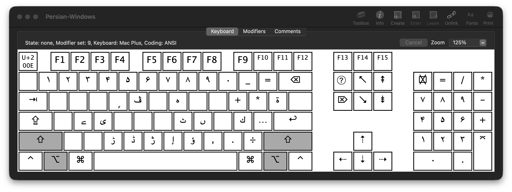
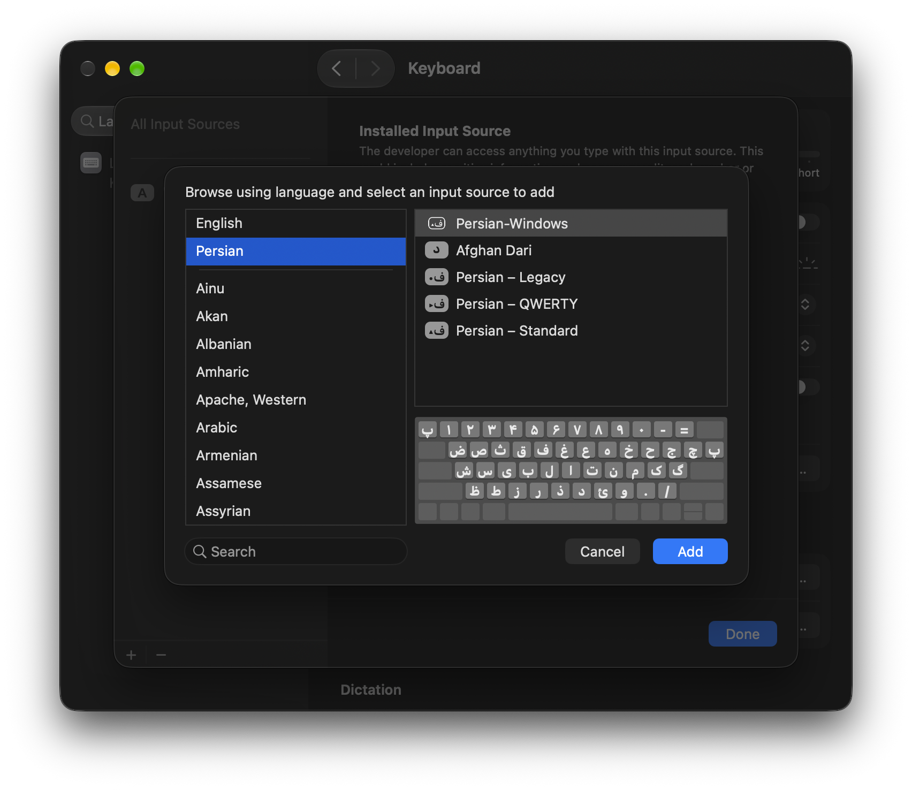

<h1 dir="rtl">چیدمان فارسی ویندوز برای <bdi dir="ltr">macOS</bdi></h1>

<p dir="rtl">
چیدمان <strong><bdi dir="ltr">Persian-Windows</bdi></strong> یک چیدمان صفحه‌کلید فارسی برای <bdi dir="ltr">macOS</bdi> است که جایگاه کلیدها را با الگوی متداول صفحه‌کلید فارسی در ویندوز هماهنگ می‌کند. این چیدمان با <a href="https://software.sil.org/ukelele/"><bdi dir="ltr">Ukelele</bdi></a> ساخته شده و به‌صورت بستهٔ قابل نصب (<code dir="ltr">.bundle</code>) همراه با آیکون اختصاصی ارائه می‌شود.
</p>

<h2 dir="rtl">ویژگی‌ها</h2>

<ul dir="rtl">
  <li>حفظ نگاشت‌های متداول صفحه‌کلید فارسی ویندوز برای حروف و علائم پرکاربرد</li>
  <li>درج نیم‌فاصله (<bdi dir="ltr">ZWNJ — U+200C</bdi>) با <bdi dir="ltr"><kbd>Shift</kbd> + <kbd>Space</kbd></bdi></li>
  <li>آیکون اختصاصی با طراحی هماهنگ با نشانگرهای ورودی <bdi dir="ltr">macOS</bdi></li>
  <li>نصب و استفاده بدون نیاز به اجرای <bdi dir="ltr">Ukelele</bdi> یا نرم‌افزار جانبی</li>
</ul>

<h2 dir="rtl">نگاشت‌های شاخص</h2>

<table dir="rtl">
  <thead>
    <tr><th align="center">کلید</th><th align="center">خروجی</th></tr>
  </thead>
  <tbody>
    <tr><td align="center"><code dir="ltr">A</code></td><td align="center">ش</td></tr>
    <tr><td align="center"><code dir="ltr">S</code></td><td align="center">س</td></tr>
    <tr><td align="center"><code dir="ltr">D</code></td><td align="center">ی</td></tr>
    <tr><td align="center"><code dir="ltr">F</code></td><td align="center">ب</td></tr>
    <tr><td align="center"><code dir="ltr">M</code></td><td align="center">ئ</td></tr>
    <tr><td align="center"><code dir="ltr">\</code></td><td align="center">پ</td></tr>
    <tr><td align="center"><code dir="ltr">Shift + Space</code></td><td align="center">نیم‌فاصله (<code dir="ltr">U+200C</code>)</td></tr>
  </tbody>
</table>

<p dir="rtl">
این جدول تنها تعدادی از نگاشت‌های اصلی را نشان می‌دهد. برای بررسی سایر کلیدها و ترکیب‌های آن‌ها، تصاویر زیر یا فایل منبع چیدمان را ببینید.
</p>

<h2 dir="rtl">پیش‌نمایش چیدمان</h2>

<h3 dir="rtl">حالت عادی</h3>

<p dir="rtl"></p>

<details dir="rtl">
  <summary>نمایش حالت‌های <bdi dir="ltr">Shift</bdi> و <bdi dir="ltr">Shift + Option</bdi></summary>
  <p dir="rtl"><strong>حالت <bdi dir="ltr">Shift</bdi></strong></p>
  <p dir="rtl"></p>
  <p dir="rtl"><strong>حالت <bdi dir="ltr">Shift + Option</bdi></strong></p>
  <p dir="rtl"></p>
</details>

<h2 dir="rtl">نصب در <bdi dir="ltr">macOS</bdi></h2>

<ol dir="rtl">
  <li>آخرین نسخه را از بخش <strong><bdi dir="ltr">Releases</bdi></strong> مخزن دریافت کنید و فایل <bdi dir="ltr">ZIP</bdi> را از حالت فشرده خارج کنید. در صورت دریافت مستقیم مخزن، بستهٔ آماده در مسیر <code dir="ltr">dist/Persian-Windows.bundle</code> قرار دارد.</li>
  <li>فایل <code dir="ltr">Persian-Windows.bundle</code> را در پوشهٔ <code dir="ltr">~/Library/Keyboard Layouts/</code> کپی کنید. در <bdi dir="ltr">Finder</bdi> می‌توانید با میان‌بُر <bdi dir="ltr"><kbd>Shift</kbd> + <kbd>Command</kbd> + <kbd>G</kbd></bdi> این مسیر را باز کنید. اگر پوشه وجود ندارد، آن را ایجاد کنید.</li>
  <li>از حساب کاربری <bdi dir="ltr">macOS</bdi> خارج شوید و دوباره وارد شوید. در صورت شناسایی نشدن چیدمان، سیستم را راه‌اندازی مجدد کنید.</li>
  <li>به بخش <bdi dir="ltr"><strong>System Settings → Keyboard → Text Input → Edit…</strong></bdi> بروید و روی دکمهٔ <code dir="ltr">+</code> کلیک کنید.</li>
  <li>از فهرست زبان‌ها، <bdi dir="ltr"><strong>Persian</strong></bdi> و سپس چیدمان <bdi dir="ltr"><strong>Persian-Windows</strong></bdi> را انتخاب و اضافه کنید.</li>
  <li>چیدمان جدید را از منوی ورودی (<bdi dir="ltr">Input</bdi>) در نوار منوی <bdi dir="ltr">macOS</bdi> انتخاب کنید.</li>
</ol>

<h3 dir="rtl">نمایش چیدمان در تنظیمات ورودی</h3>

<p dir="rtl"></p>

<blockquote dir="rtl"><p dir="rtl"><strong>توجه:</strong> این بسته یک چیدمان سفارشی است و جایگزین خودکار چیدمان‌های پیش‌فرض <bdi dir="ltr">macOS</bdi> نمی‌شود.</p></blockquote>

<h3 dir="rtl">نصب از طریق <bdi dir="ltr">Terminal</bdi></h3>

<p dir="rtl">اگر در پوشهٔ اصلی مخزن قرار دارید، می‌توانید بسته را با دستورهای زیر نصب کنید:</p>

```bash
mkdir -p "$HOME/Library/Keyboard Layouts"
cp -R "dist/Persian-Windows.bundle" "$HOME/Library/Keyboard Layouts/"
```

<p dir="rtl">پس از کپی، یک‌بار از حساب کاربری خارج شوید و دوباره وارد شوید؛ سپس چیدمان را از تنظیمات کیبورد اضافه کنید.</p>

<h2 dir="rtl">حذف چیدمان</h2>

<ol dir="rtl">
  <li>در بخش <bdi dir="ltr"><strong>System Settings → Keyboard → Text Input → Edit…</strong></bdi>، چیدمان <bdi dir="ltr"><strong>Persian-Windows</strong></bdi> را از منابع ورودی حذف کنید.</li>
  <li>فایل <code dir="ltr">Persian-Windows.bundle</code> را از مسیر <code dir="ltr">~/Library/Keyboard Layouts/</code> حذف کنید.</li>
  <li>از حساب کاربری خارج شوید و دوباره وارد شوید؛ در صورت نیاز سیستم را راه‌اندازی مجدد کنید.</li>
</ol>

<h2 dir="rtl">فایل‌های پروژه</h2>

<table dir="rtl">
  <thead>
    <tr><th>مسیر</th><th>توضیح</th></tr>
  </thead>
  <tbody>
    <tr><td><code dir="ltr">src/Persian-Windows.keylayout</code></td><td>تعریف قابل ویرایش نگاشت کلیدها</td></tr>
    <tr><td><code dir="ltr">dist/Persian-Windows.bundle</code></td><td>بستهٔ آمادهٔ نصب، شامل چیدمان و آیکون</td></tr>
    <tr><td><code dir="ltr">artwork/</code></td><td>فایل‌های منبع طراحی آیکون، در صورت انتشار</td></tr>
    <tr><td><code dir="ltr">screenshots/</code></td><td>تصاویر چیدمان و انتخاب منبع ورودی</td></tr>
  </tbody>
</table>

<p dir="rtl">
برای ویرایش فایل <code dir="ltr">.keylayout</code> یا ساخت مجدد بستهٔ نصب می‌توان از <a href="https://software.sil.org/ukelele/"><bdi dir="ltr">Ukelele</bdi></a> استفاده کرد. استفادهٔ روزمره از چیدمان نیازی به نصب این نرم‌افزار ندارد.
</p>

<h2 dir="rtl">گزارش مشکل و مشارکت</h2>

<p dir="rtl">
برای گزارش اشکال در نگاشت کلیدها یا نصب، از بخش <bdi dir="ltr"><strong>Issues</strong></bdi> مخزن استفاده کنید. ذکر نسخهٔ <bdi dir="ltr">macOS</bdi>، نوع صفحه‌کلید و مراحل بازتولید مشکل به بررسی دقیق‌تر کمک می‌کند.
</p>

<h2 dir="rtl">مجوز</h2>

<p dir="rtl">شرایط استفاده، تغییر و بازنشر پروژه در فایل <a href="LICENSE"><bdi dir="ltr">LICENSE</bdi></a> مشخص شده است.</p>
